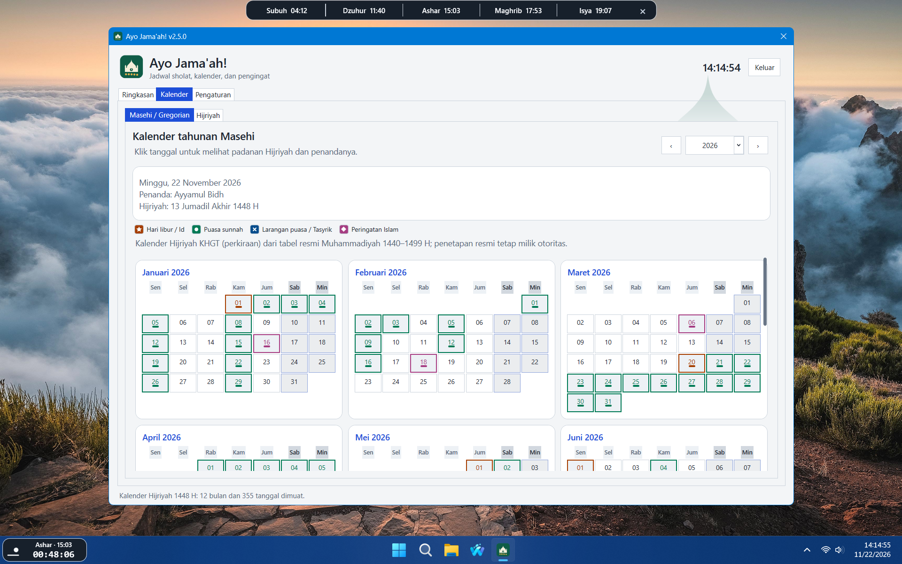
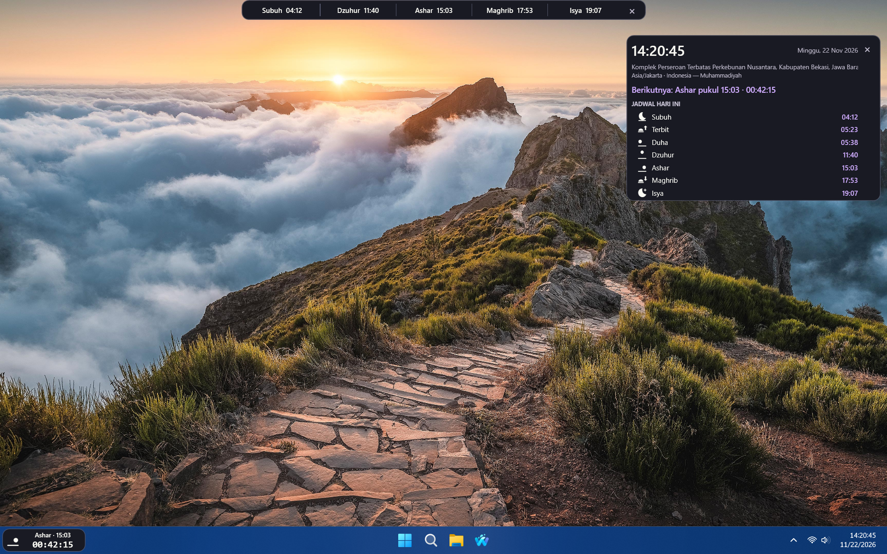

# Ayo Jama'ah!

Aplikasi pengingat sholat untuk Windows yang tujuannya satu: membuat kita **berhenti kerja** waktu sholat tiba. Notifikasi sebelum waktu sholat, lalu PC/laptop dikunci sementara, supaya kita bersegera ke masjid, bukan menunda-nunda.

## Ceritanya kenapa saya bikin ini

Berawal dari keresahan saya di kantor. Di HP saya sudah ada aplikasi pengingat sholat, tapi saya sering mengabaikan alarm-nya, menunda-nunda, ujung-ujungnya kelewatan jamaah di masjid/mushola kantor.

Saya coba cari aplikasi pengingat sholat di internet — semuanya cuma membunyikan adzan dan tidak benar-benar memutus pekerjaan. Padahal yang saya butuhkan bukan suara adzan, saya butuh dipaksa berhenti.

Akhirnya saya buat sendiri: cukup notifikasi sebelum waktu sholat, lalu layar Windows dikunci sementara. Tinggalkan urusan dunia, bersegera ke masjid.

## Cara kerjanya

- Muncul pengingat sebelum waktu sholat (teks saja, tanpa suara/adzan).
- Setelah itu Windows dikunci sementara; kamu harus benar-benar berhenti kerja.
- Jadwal dihitung di komputer, tidak perlu internet; ada beberapa pilihan metode perhitungan, termasuk Muhammadiyah dengan sudut Subuh/Isya 18°, ihtiyat 1–2 menit, dan ketinggian tempat (mdpl).
- Ada kalender Masehi & Hijriyah, widget desktop, panel taskbar, dan pengingat.
- Lokasi bisa diisi manual, dipilih dari data offline, diperkirakan dari jaringan, atau dideteksi dari Windows Location Services. Saat instalasi baru, lokasi dicoba dideteksi otomatis.
- Pencarian nama tempat berjalan offline (GeoNames + hierarki wilayah Kemendagri). Paket data global lengkap bisa diunduh opsional; Nominatim online juga opsional (default mati) dengan fallback offline.
- Pembaruan bisa diperiksa sendiri dari GitHub: tombol "Periksa sekarang" di Pengaturan tambahan atau menu ikon tray.
- Jadwal yang muncul adalah hasil hitung aplikasi, bukan pengumuman resmi.

## Cara pakai

1. Unduh installer atau portable di bawah, lalu jalankan/pasang.
2. Buka pengaturan, cek lokasi, zona waktu, dan metode perhitungan.
3. Atur kapan notifikasi muncul, simpan, selesai.
4. Kalau waktu sholat tiba, tinggalkan layar dan bersegera ke masjid.

## Tangkapan layar

Tangkapan layar dari build 2.5.2:

| | |
|---|---|
|  |  |
| Halaman utama | Ringkasan, standar perhitungan, dan lokasi |
|  |  |
| Tema, pengingat, dan widget | Pengaturan tambahan |
|  |  |
| Kalender Masehi | Kalender Hijriyah |
|  |  |
| Berbagai widget di desktop | Pengingat sebelum waktu sholat |

Beberapa menit sebelum waktu sholat, pengingat muncul di pojok kanan bawah layar. Teks saja, tanpa suara, dan hilang sendiri setelah 12 detik. Jumlah menit serta isi pesannya bisa diatur sendiri.

## Unduh

### v2.5.3 (stable terbaru)

Rilis ini menyelesaikan pengerasan pembaruan dan pemuatan pustaka native: ukuran respons dibatasi sebelum diverifikasi, parser catatan rilis memakai regex waktu-linear, dan `prayer_core` hanya dimuat dari folder aplikasi. Perbaikan installer dan uninstall dari v2.5.2 tetap termasuk. Aplikasi tetap self-contained tanpa perlu .NET Runtime terpisah. Rilis [`v2.5.3`](https://github.com/ASQAL90/PrayerAutomation/releases/tag/v2.5.3) dibangun oleh workflow `Release`.

| Berkas | Keterangan |
|---|---|
| [AyoJamaah.Setup-2.5.3.exe](https://github.com/ASQAL90/PrayerAutomation/releases/download/v2.5.3/AyoJamaah.Setup-2.5.3.exe) | Installer universal (x64+x86) |
| [AyoJamaah.Setup-2.5.3-x64.exe](https://github.com/ASQAL90/PrayerAutomation/releases/download/v2.5.3/AyoJamaah.Setup-2.5.3-x64.exe) | Installer x64 |
| [AyoJamaah.Setup-2.5.3-x86.exe](https://github.com/ASQAL90/PrayerAutomation/releases/download/v2.5.3/AyoJamaah.Setup-2.5.3-x86.exe) | Installer x86 (32-bit) |
| [AyoJamaah-win-x64.zip](https://github.com/ASQAL90/PrayerAutomation/releases/download/v2.5.3/AyoJamaah-win-x64.zip) | Portable x64 |
| [AyoJamaah-win-x86.zip](https://github.com/ASQAL90/PrayerAutomation/releases/download/v2.5.3/AyoJamaah-win-x86.zip) | Portable x86 (32-bit) |
| [SHA256SUMS.txt](https://github.com/ASQAL90/PrayerAutomation/releases/download/v2.5.3/SHA256SUMS.txt) | Checksum SHA-256 semua berkas |

Aset pembaruan delta (`AyoJamaah-update-2.5.3-*.json`, `.sig`, dan `AyoJamaah-delta-2.5.3-*.zip`) juga tersedia di [rilis v2.5.3](https://github.com/ASQAL90/PrayerAutomation/releases/tag/v2.5.3) untuk updater aplikasi. Versi lama tetap ada di [daftar rilis](https://github.com/ASQAL90/PrayerAutomation/releases).

Installer dan portable belum ditandatangani, jadi SmartScreen akan memberi peringatan pertama kali jalan.

## Lisensi

MIT, lihat [LICENSE](LICENSE). Komponen pihak ketiga mengikuti lisensinya masing-masing (GeoTimeZone/Geohash, ODbL untuk data boundary, TimeZoneConverter, GeoNames CC BY 4.0, runtime .NET 10).
