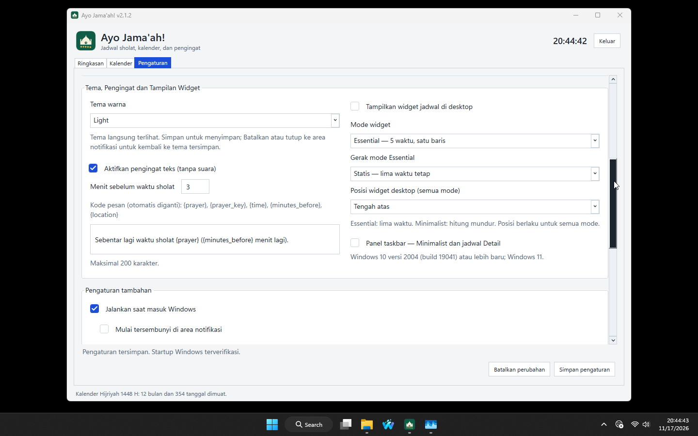
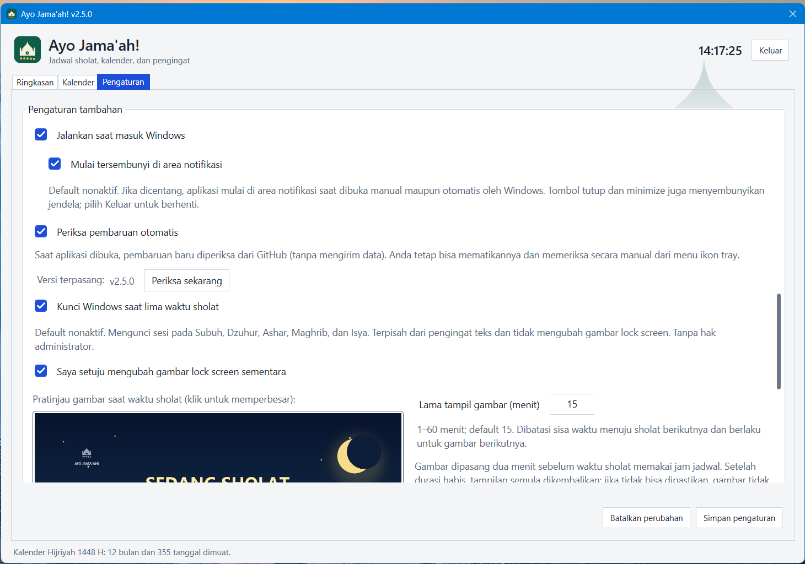
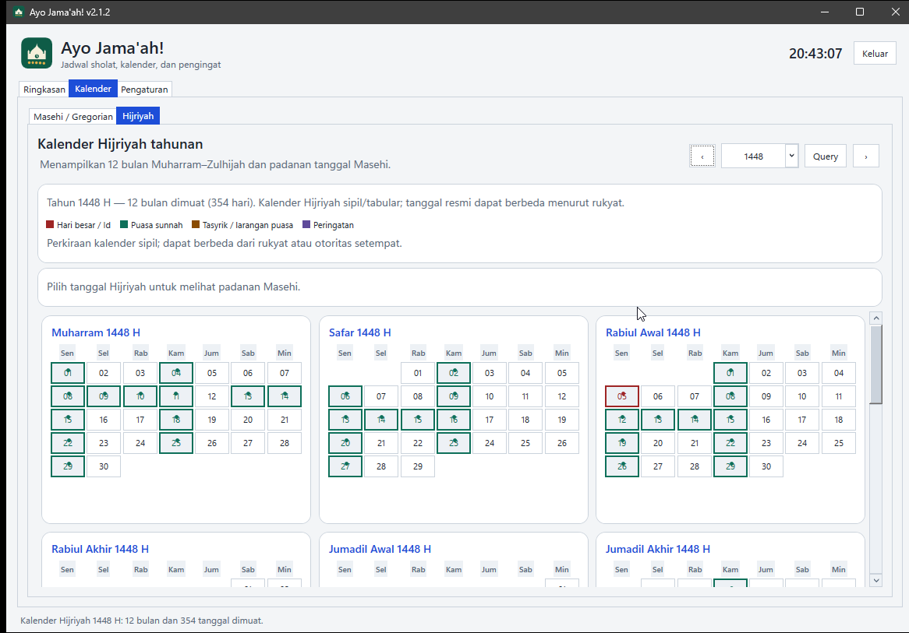

# Ayo Jama'ah!

Aplikasi pengingat sholat untuk Windows yang tujuannya satu: membuat kita **berhenti kerja** waktu sholat tiba. Notifikasi sebelum waktu sholat, lalu PC/laptop dikunci sementara, supaya kita bersegera ke masjid, bukan menunda-nunda.

## Ceritanya kenapa saya bikin ini

Berawal dari keresahan saya di kantor. Di HP saya sudah ada aplikasi pengingat sholat, tapi saya sering mengabaikan alarm-nya, menunda-nunda, ujung-ujungnya kelewatan jamaah di masjid/mushola kantor.

Saya coba cari aplikasi pengingat sholat di internet — semuanya cuma membunyikan adzan dan tidak benar-benar memutus pekerjaan. Padahal yang saya butuhkan bukan suara adzan, saya butuh dipaksa berhenti.

Akhirnya saya buat sendiri: cukup notifikasi sebelum waktu sholat, lalu layar Windows dikunci sementara. Tinggalkan urusan dunia, bersegera ke masjid.

## Cara kerjanya

- Muncul pengingat sebelum waktu sholat (teks saja, tanpa suara/adzan).
- Setelah itu Windows dikunci sementara; kamu harus benar-benar berhenti kerja.
- Jadwal dihitung di komputer, tidak perlu internet, ada beberapa pilihan metode perhitungan.
- Metode Muhammadiyah memakai sudut Subuh/Isya 18°, ihtiyat 1–2 menit, dan ketinggian tempat (mdpl) untuk menyesuaikan terbit dan Maghrib.
- Ada kalender Masehi & Hijriyah, widget desktop, dan pengingat.
- Lokasi bisa diisi manual, diperkirakan dari jaringan, atau dari Windows Location Services.
- Cari nama tempat offline pakai data GeoNames.
- Pembaruan bisa diperiksa sendiri dari GitHub: tombol "Periksa sekarang" di Pengaturan tambahan atau menu ikon tray.
- Jadwal yang muncul adalah hasil hitung aplikasi, bukan pengumuman resmi.

## Cara pakai

1. Unduh installer atau portable di bawah, lalu jalankan/pasang.
2. Buka pengaturan, cek lokasi, zona waktu, dan metode perhitungan.
3. Atur kapan notifikasi muncul, simpan, selesai.
4. Kalau waktu sholat tiba, tinggalkan layar dan bersegera ke masjid.

## Tangkapan layar

|  |  |
|---|---|
|  |  |
| Ringkasan jadwal harian (tema terang) | Tema, pengingat, dan widget |
|  |  |
| Startup, kunci Windows & gambar lock screen | Kalender Masehi tahunan |
|  |  |
| Kalender Hijriyah tahunan | Pengaturan, widget & jadwal di desktop (tema gelap) |

Beberapa menit sebelum waktu sholat, pengingat muncul di pojok kanan bawah layar. Teks saja, tanpa suara, dan hilang sendiri setelah 12 detik. Gambar di bawah adalah **mock desain, bukan tangkapan layar asli**; jam, nama sholat, dan isi pesannya hanya contoh. Jumlah menit serta isi pesan sebenarnya bisa diatur sendiri.

## Unduh

### v2.4.2 (terbaru)

Ringkasan perubahan ditampilkan di popup pembaruan, riwayat seluruh versi tersedia dari halaman Tentang, dan preflight pembaruan menyelesaikan pemulihan lock screen tanpa menahan proses. Pemasang manual menampilkan konfirmasi bila versi terpasang sama atau lebih baru.

| Berkas | Keterangan |
|---|---|
| [AyoJamaah.Setup-2.4.2.exe](https://github.com/asqal90/PrayerAutomation/releases/download/v2.4.2/AyoJamaah.Setup-2.4.2.exe) | Installer, dual x64+x86 |
| [AyoJamaah.Setup-2.4.2.zip](https://github.com/asqal90/PrayerAutomation/releases/download/v2.4.2/AyoJamaah.Setup-2.4.2.zip) | Installer dalam file zip |
| [AyoJamaah-win-x64.zip](https://github.com/asqal90/PrayerAutomation/releases/download/v2.4.2/AyoJamaah-win-x64.zip) | Portable x64 |
| [AyoJamaah-win-x86.zip](https://github.com/asqal90/PrayerAutomation/releases/download/v2.4.2/AyoJamaah-win-x86.zip) | Portable x86 (32-bit) |
| [SHA256SUMS.txt](https://github.com/asqal90/PrayerAutomation/releases/download/v2.4.2/SHA256SUMS.txt) | Checksum SHA-256 semua berkas |

Aset pembaruan delta (`AyoJamaah-update-2.4.2-*.json`, `.sig`, dan `AyoJamaah-delta-2.4.2-*.zip`) juga tersedia di [rilis v2.4.2](https://github.com/asqal90/PrayerAutomation/releases/tag/v2.4.2) untuk updater aplikasi. Versi lama tetap ada di [daftar rilis](https://github.com/asqal90/PrayerAutomation/releases).

Installer dan portable belum ditandatangani, jadi SmartScreen akan memberi peringatan pertama kali jalan.

## Lisensi

MIT, lihat [LICENSE](LICENSE). Komponen pihak ketiga mengikuti lisensinya masing-masing (GeoTimeZone/Geohash, ODbL untuk data boundary, TimeZoneConverter, GeoNames CC BY 4.0, runtime .NET 10).
